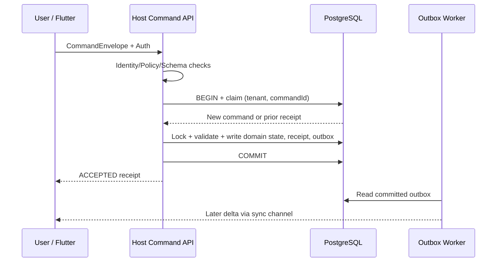
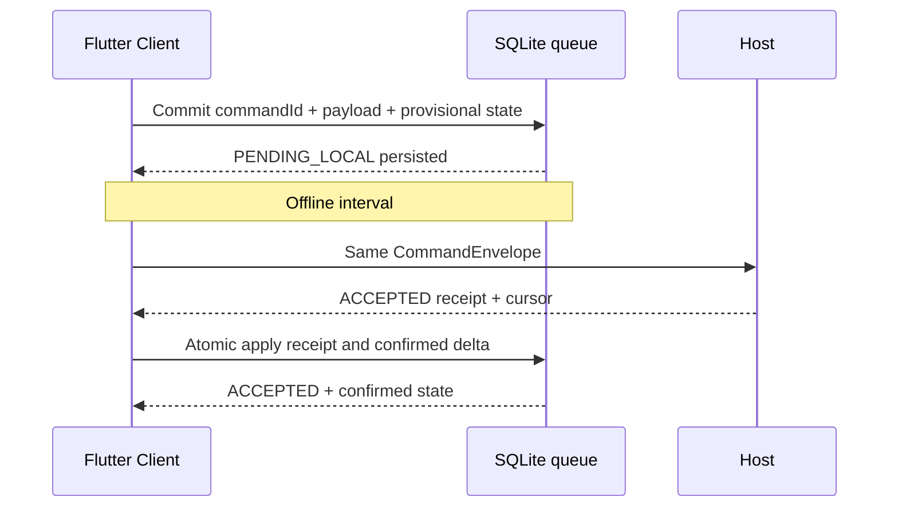
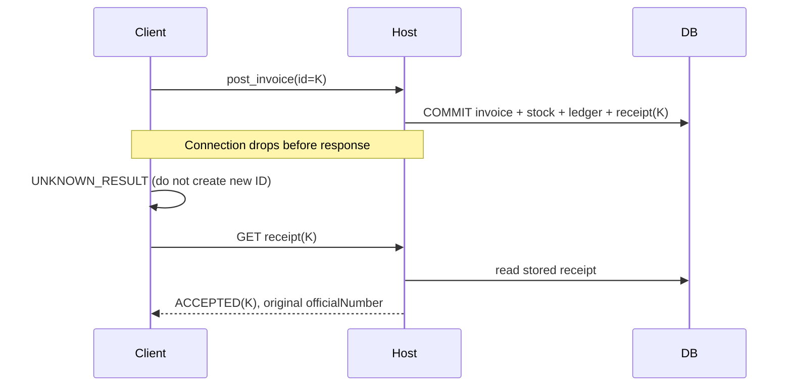
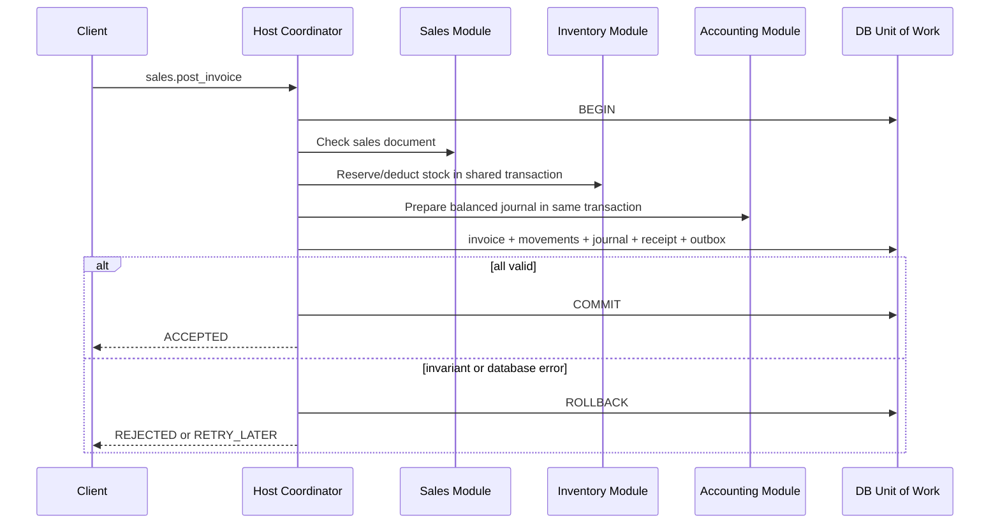

# Command processing — Sequence Diagrams (proposal)

## 1. Online accepted



## 2. Offline operation followed by Host acceptance



## 3. Network failure after commit (unknown result)



## 4. Business conflict and recovery

```mermaid
sequenceDiagram
    participant A as Client A
    participant B as Client B
    participant H as Host
    A->>H: Sell 10 from available 15
    H-->>A: ACCEPTED (remaining 5)
    B->>H: Sell 10 from same stock
    H-->>B: CONFLICT / INSUFFICIENT_STOCK
    B->>B: NEEDS_RESOLUTION; display explanation
    B->>H: New corrected command ID if user accepts
```

## 5. Multi-module atomic post



These are target protocols, **not deployed or benchmarked implementations**.
